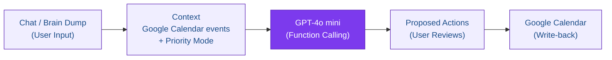
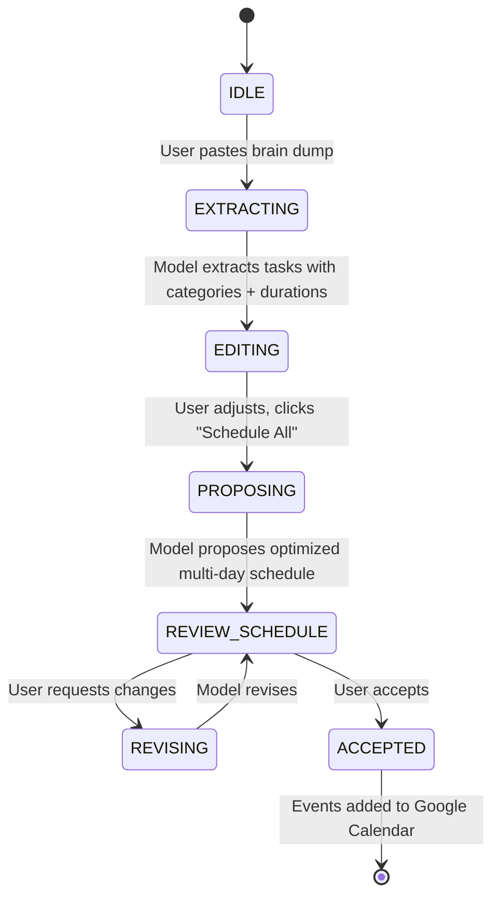

# Kaisey — Your AI Co-Pilot for Student Life

> An AI co-pilot for Google Calendar. Brain-dump everything on your plate and Kaisey schedules it around your classes, recruiting, and social life, adjusting for what matters most to you this week.

**[Case Study](https://anishasubs.github.io/portfolio/kaisey-case-study/)** · **[Live App](https://anishasubs.github.io/portfolio/kaisey/index.html)**

<p align="center">
  
  <br/>
  <em>Scan to try the live demo</em>
</p>

---

## Why Kaisey Stands Out

- **Real student problem, not a toy demo.** Built by students who deal with competing calendars every day.
- **Brain dump to calendar in one flow.** Paste a messy to-do list. Kaisey turns it into tasks, proposes a schedule, and writes it to Google Calendar once you approve.
- **Priority-aware scheduling.** Pick Academics, Recruiting, Social, or Wellness. That choice changes how the AI fills your week.
- **Human in the loop.** Every change is shown as a proposal first. Nothing is written to your calendar until you accept it.
- **No server-side storage.** There's no Kaisey database. AI requests go through a stateless proxy that only exists to keep the API key off the client.

---

## The Problem

Students don't have busy calendars. They have **competing calendars** that work against each other.

| | |
|---|---|
| **6+ tools** | the average student juggles daily just to stay on schedule |
| **73%** | have missed a deadline because the reminder lived in a different app |
| **2.4 hrs/week** | lost mentally stitching calendars, inboxes, and to-do lists together |

Your problem-set deadline doesn't know about your Super Day. Your club dinner doesn't know about either one. Miss one recruiting deadline and you can lose a job offer. Forget one group meeting and your team stops trusting you.

---

## What Kaisey Does

| Feature | Description |
|---------|-------------|
| **Brain Dump Planner** | Paste everything on your mind. Kaisey extracts each task with a category, priority, and duration estimate, then proposes a multi-day schedule around your existing events. Revise it in chat, then accept. |
| **Chat to Schedule** | "Add gym Monday, Wednesday, Friday at 7am for six weeks." Add, remove, or reschedule events (including recurring series) in plain language. If you don't give a time, Kaisey suggests a free slot. |
| **Priority Mode** | Academics, Recruiting, Social, or Wellness. Steers the AI's scheduling, switches "Up Next" to your next event in that category, and flags when your week drifts away from it. |
| **Your Day at a Glance** | Next event, weekly time balance across all four categories, and warnings like "No wellness time scheduled this week." |
| **Agent Suggestions** | Spots overlapping events, back-to-back meetings with no buffer, and blocks of 2 hours or more. Offers a fix for each: move the event, add a 15-minute buffer, or split the block with a break. |
| **Day / Week / Month Calendar** | Color-coded by category. Edit or delete in place; changes sync to Google Calendar. |
| **Demo Mode** | Try every feature on a sample student week without connecting a calendar. |

---

## Architecture

### System Flow



```
┌──────────────┐        ┌──────────────────┐        ┌──────────────┐
│ React (Vite) │───────▶│ Vercel serverless│───────▶│ OpenAI API   │
│ GitHub Pages │        │ proxy /api/chat  │        │ gpt-4o-mini  │
└──────┬───────┘        └──────────────────┘        └──────────────┘
       │
       │  OAuth 2.0 (read/write)
       ▼
┌──────────────────┐
│ Google Calendar  │
│ API              │
└──────────────────┘
```

**Data flow**

1. User signs in with Google (or starts Demo Mode) and picks a priority mode.
2. Frontend loads events from Google Calendar.
3. Chat or brain-dump input is sent to the proxy with the existing events, the current date/time, and the priority mode.
4. The model replies with a structured function call (never free text that the app has to interpret).
5. The UI renders the proposal; the user accepts, revises, or dismisses.
6. Accepted changes go through `handleScheduleChange()` in `App.tsx`, which updates local state and writes to Google Calendar.

### Function-Calling Tools

| Tool | Used by | Returns |
|------|---------|---------|
| `calendar_action` | Chat | Add / remove / replace an event, with optional recurrence (daily/weekly/monthly, days, until/count) |
| `extract_tasks` | Brain dump, step 1 | Tasks with title, duration, due date, preferred time, priority, category |
| `propose_schedule` | Brain dump, step 2 | Dated time blocks, recommendations, and a summary |

### Scheduling Guardrails (in the prompt)

- Never overlap existing events; never schedule in the past
- 15-minute buffer between back-to-back events
- Nothing after 10:00 PM
- Honor any exact time the user asked for
- Apply the priority-mode hint (e.g. recruiting mode gives interview prep the best slots)

### Brain Dump Pipeline



---

## Product Decisions

| Decision | Chose | Over | Why |
|----------|-------|------|-----|
| **Auth** | Google OAuth | Email/Password | One sign-in gives calendar read/write access. No separate account and nothing to import. |
| **Interaction** | Four priority modes | Manual ranking UI | One tap changes scheduling bias, Up Next, and imbalance warnings. Fast enough to switch mid-day. |
| **Output** | Function calling | Free-text replies | Structured actions the UI can render and the user can approve; no parsing guesswork. |
| **Trust** | Propose, then write | Silent auto-apply | One bad auto-reschedule and a student stops trusting the tool. The extra tap is worth it. |
| **Data** | No backend database | Persistent storage | Events go straight from Google to the browser; the proxy is stateless. |

---

## Tech Stack

| Layer | Technology |
|-------|-----------|
| **Frontend** | React 18, TypeScript, Vite, Tailwind CSS, shadcn/ui, Framer Motion |
| **AI** | OpenAI gpt-4o-mini with function calling |
| **Calendar** | Google Calendar API (OAuth 2.0, read/write) |
| **Backend** | Vercel serverless function (`kaisey-proxy/api/chat.ts`) — OpenAI proxy with CORS allow-list and per-IP rate limiting |
| **Deployment** | GitHub Pages (frontend), Vercel (proxy) |
| **Built with** | Claude Code (agentic dev), Figma MCP (design-to-component handoff) |

---

## Local Setup

```bash
# 1. Clone the repo
git clone https://github.com/anishasubs/portfolio.git
cd portfolio/kaisey-src

# 2. Install dependencies
npm install

# 3. (Optional) environment overrides in .env
#   VITE_GOOGLE_CLIENT_ID=your_google_client_id
#   VITE_OPENAI_PROXY_URL=http://localhost:3000/api/chat

# 4. Start the dev server
npm run dev   # http://localhost:5173
```

### Build

```bash
rm -rf ../kaisey/assets && npx vite build   # outputs to ../kaisey/
```

### Backend Proxy

```bash
cd ../kaisey-proxy
npm install
# Set OPENAI_API_KEY in the Vercel dashboard
npx vercel --prod
```

---

## Key Files

| File | Role |
|------|------|
| `src/app/App.tsx` | Root component — all state, demo data, agent suggestions, calendar mutations |
| `src/app/components/KaiseyChatbot.tsx` | AI chat + brain dump (7-phase state machine) |
| `src/app/components/CommandCenter.tsx` | "Your Day at a Glance" — next event, weekly balance |
| `src/app/components/CalendarView.tsx` | Day/Week/Month calendar with edit/delete |
| `src/app/components/PrioritySelector.tsx` | Four-mode priority selector |
| `src/app/components/priority.ts` | Priority configs, prompt hints, balance + imbalance logic |
| `src/app/components/ProfileSection.tsx` | Google profile + connected services |
| `src/config/env.ts` | Environment variable configuration |
| `../kaisey-proxy/api/chat.ts` | OpenAI serverless proxy |

---

## Roadmap

| Phase | Timeline | Description |
|-------|----------|-------------|
| **Phase 1 — Validate** | Spring 2026 · 20 CBS students | Closed beta measuring daily active usage, mode switches, missed deadlines |
| **Phase 2 — A Co-Pilot That Learns** | Summer 2026 · Personalization | Learn from re-categorized tasks and corrected durations so each brain dump gets closer to right the first time |
| **Phase 3 — Event Discovery** | Fall 2026 · LinkUp Integration | Connect to Luma and Meetup via LinkUp to surface recruiting events, hackathons, and networking mixers that match your priority mode |
| **Phase 4 — Multi-University** | Fall 2026 · 5 partner schools | Career services partnerships; each school sharpens the model's scheduling patterns |
| **Phase 5 — Beyond Students** | 2027 · Professionals | The priority-mode + brain-dump pattern for anyone juggling deep work, meetings, and a life outside them |

---

## Team

| Name | Role |
|------|------|
| **Anisha Subberwal** | Product Lead, Frontend |
| **Annie Kaur** | AI Architecture |
| **Tiantian Luo** | Backend, API Proxy, Calendar Sync |
| **Siddhant Patra** | UX Design, Brain Dump Flow |

---

<p align="center">
  <em>"The goal isn't another productivity app. It's a system that understands the rhythm of your life and adapts with you."</em>
</p>
